# Dashboard capture in Penpot

The current dashboard, reproduced in the self-hosted Penpot (2.19.3) as a starting point for the design study (#128): tokens, components and screens, checked against the packaged app.

`src/renderer/src/styles/tokens.css` stays the master of the tokens. Nothing here generates CSS; that switch is #129.

## Files

| File | Content |
|---|---|
| `dock-n-roll.penpot` | The Penpot file (menu > File > Download Penpot file). Import it from the Penpot dashboard. |
| `tokens.json` | The token sets and themes, as Penpot stores them (`tokens.json` inside the `.penpot` archive). |
| `exports/<screen>-<width>-<theme>.png` | One PNG per screen frame, exported from Penpot. |
| `exports/components/<component>.png` | The main instance of each component, at 2x. |
| `reference/<screen>-<width>-<theme>.png` | The same screen in the packaged app (`dist/linux-unpacked`), full page. |

## Tokens

Three sets, two themes. A colour changes with the active colour set, so one frame serves both themes.

| Set | Tokens | Source in `tokens.css` |
|---|---|---|
| `global` | `space.1`–`space.5`, `radius`, `border.width`, `border.width-strong`, `size.badge`, `size.actions-width`, `font.family.body`, `font.family.mono`, `font.size.small`, `font.size.body`, `font.size.title` | `:root` |
| `color/light` | `color.bg`, `color.fg`, `color.muted`, `color.line`, `color.hover`, `color.banner`, `color.warning`, `color.error`, `status.on`, `status.off`, `status.transitional`, `status.unavailable` | `:root` |
| `color/dark` | the same twelve names | `@media (prefers-color-scheme: dark)` |

| Theme | Sets |
|---|---|
| `mode/light` | `global`, `color/light` |
| `mode/dark` | `global`, `color/dark` |

Differences with `tokens.css`:

- `--color-line`, `--color-hover` and `--color-banner` are `color-mix()` expressions in CSS. Penpot has no such function: each set holds the computed `rgba()` value.
- `--divider` is a border shorthand, not a token in Penpot: dividers are 1 px rectangles filled with `color.line`.
- Font weights (400, 600) and the line height (1.4) are not tokens in the CSS either; they are set on each text.
- `system-ui` resolves to Noto Sans on the reference machine. Chromium on Linux does not support `ui-monospace`, so the mono stack falls back to DejaVu Sans Mono.
- DejaVu Sans Mono is not a Google font: it is uploaded to the Penpot team as a custom font (regular and bold). The `.penpot` file does not embed it; upload `DejaVuSansMono.ttf` before importing the file elsewhere.

## Components

| Component | Variants | Export |
|---|---|---|
| `status-badge` | `on`, `off`, `transitional`, `unavailable`, `greyed` |      |
| `action-button` | `default`, `primary`, `disabled` |    |
| `service-row` | `wide`, `narrow` | 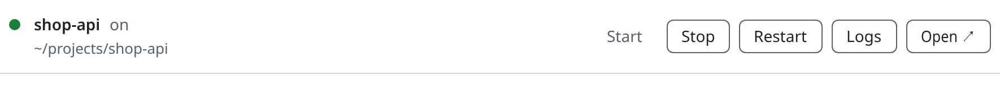 |
| `group-section` | one | 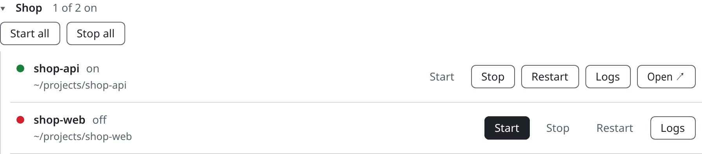 |

The exports are at 2x. `service-row / narrow`: `exports/components/service-row-narrow.png`.

## Screens

Ten frames: four screens at two widths in light, and the service list in dark. The data is a fixture (fake Docker daemon, temporary pin file): no real project appears.

The app window is 960 or 320 px wide. A page taller than the window shows a 15 px scrollbar, so its content, and its frame, is 945 or 305 px wide. Only the service list at 960 px fits the window. The reference of a taller page is taken at 945 or 305 px with a window as tall as the page, so it shows the same layout without the scrollbar.

Left: the packaged app. Right: the Penpot export.

### Service list with groups

| Width, theme | App | Penpot |
|---|---|---|
| 960, light | 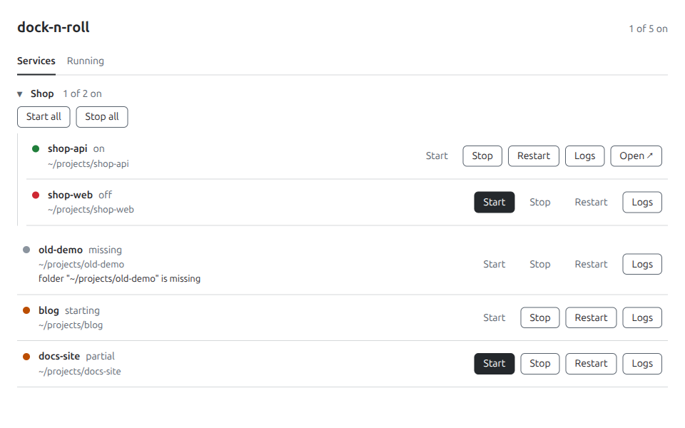 | 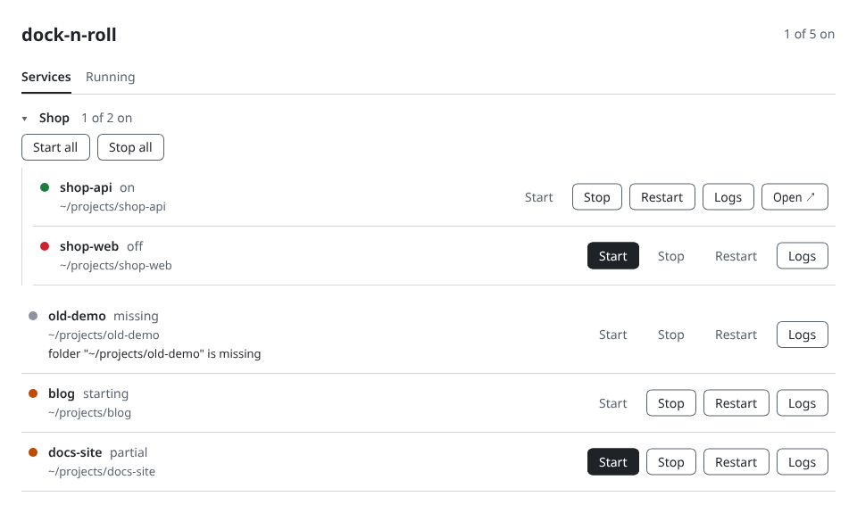 |
| 960, dark | 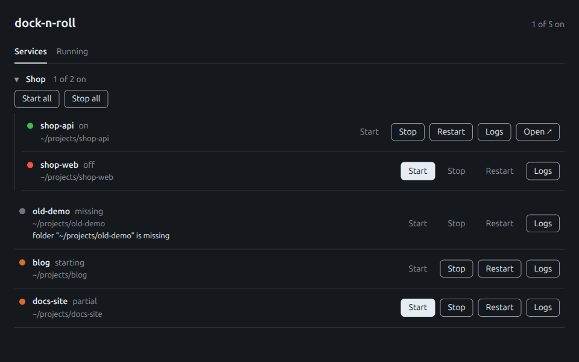 | 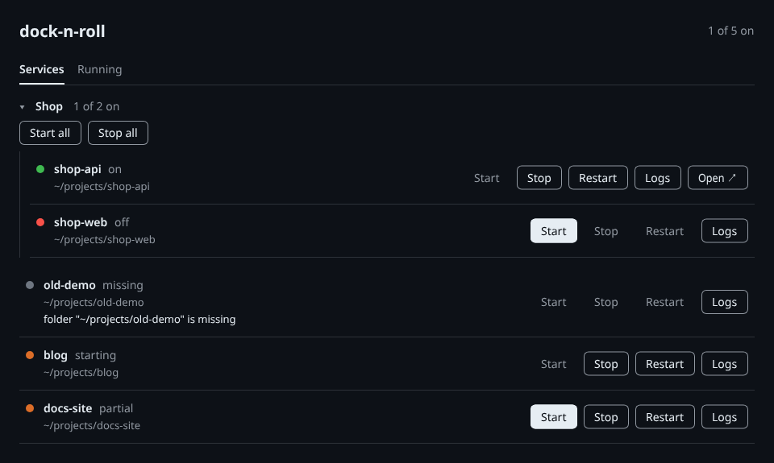 |
| 320, light | 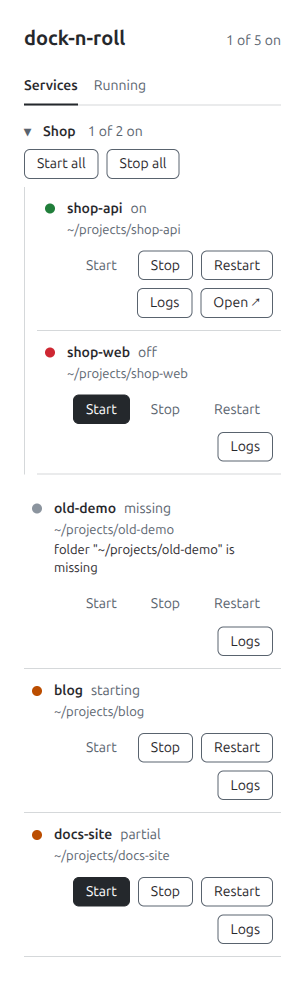 | 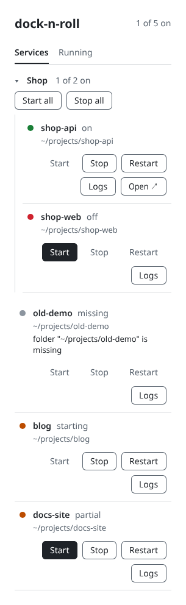 |
| 320, dark | 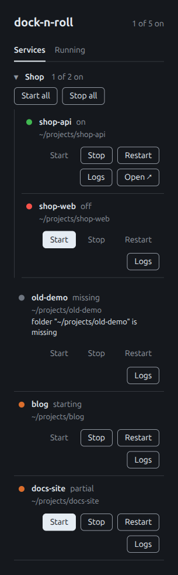 | 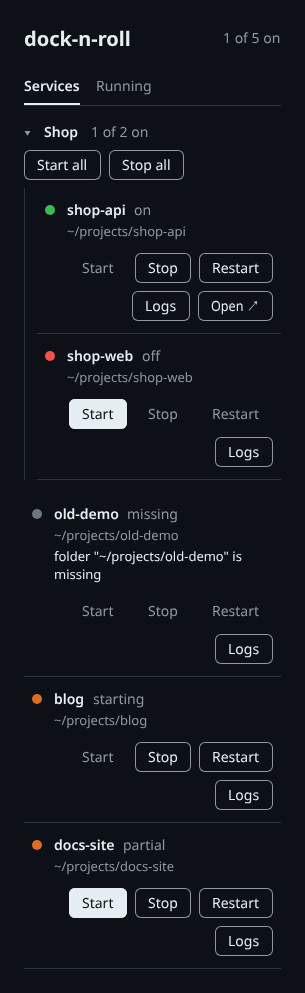 |

### Logs panel

| Width | App | Penpot |
|---|---|---|
| 960 | 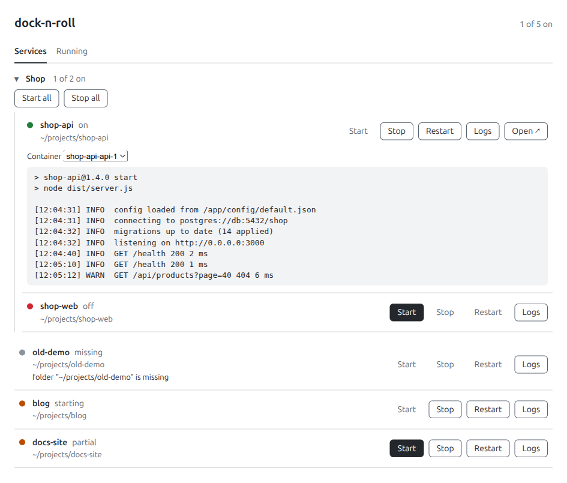 | 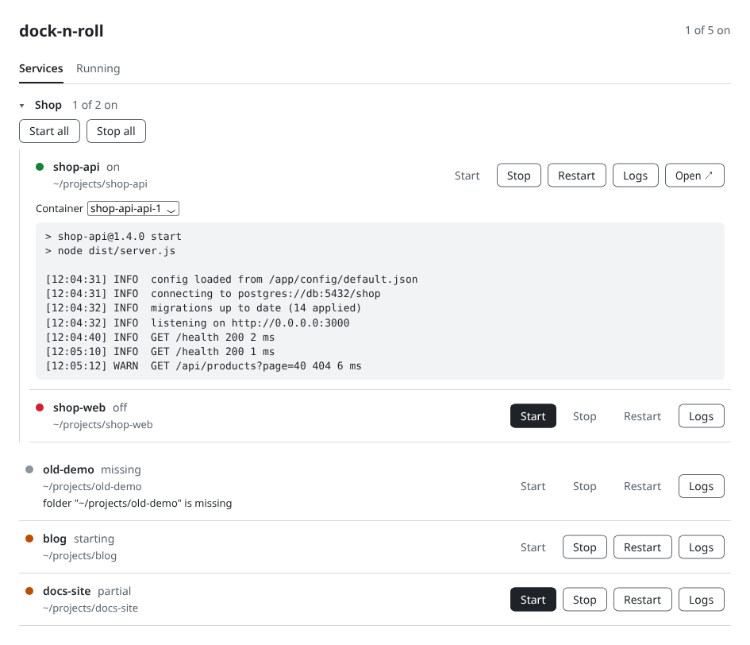 |
| 320 | 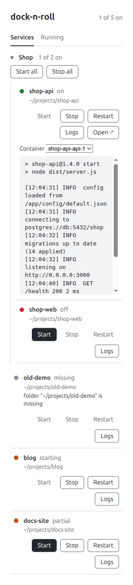 | 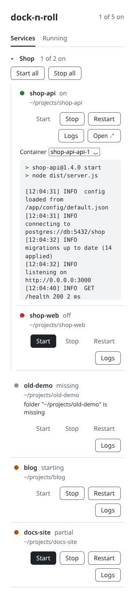 |

### Running tab

| Width | App | Penpot |
|---|---|---|
| 960 | 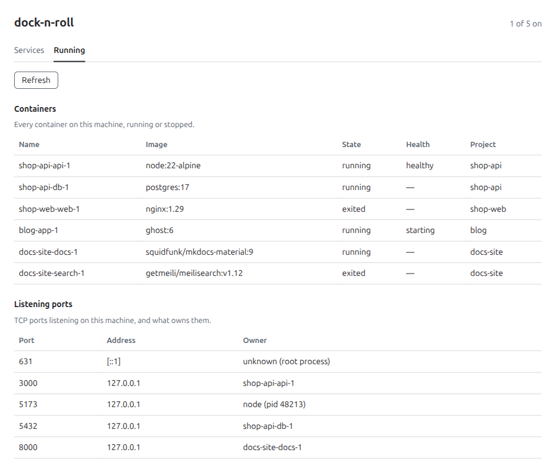 | 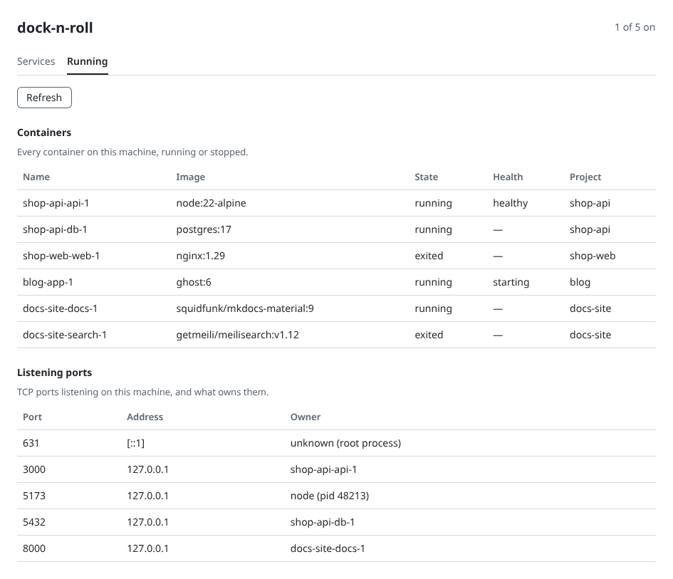 |
| 320 | 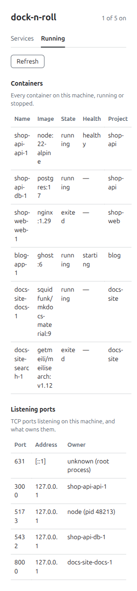 | 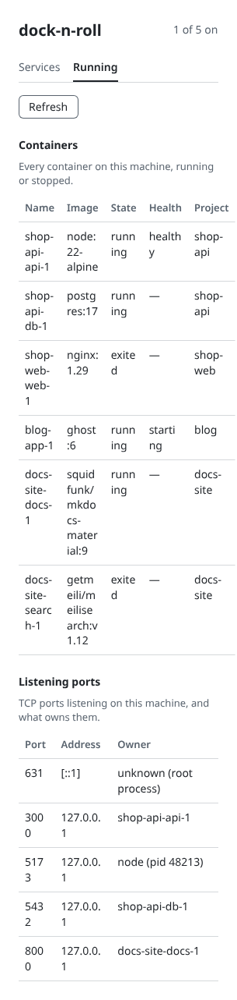 |

### Banners (pin-file error and Docker down)

| Width | App | Penpot |
|---|---|---|
| 960 | 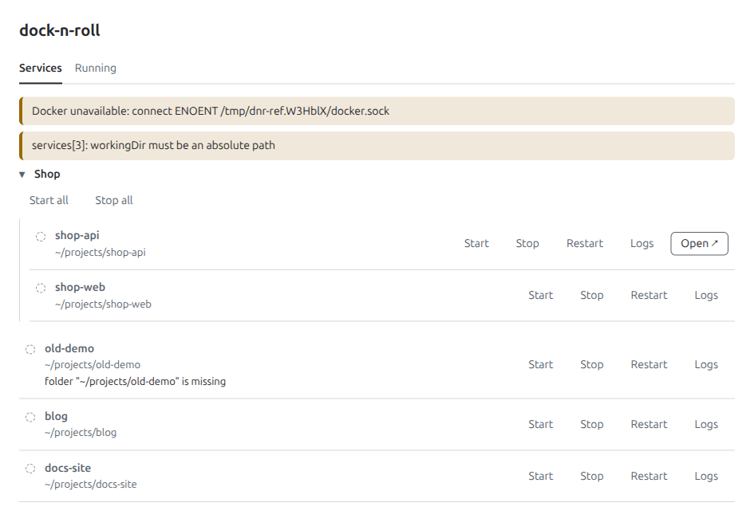 | 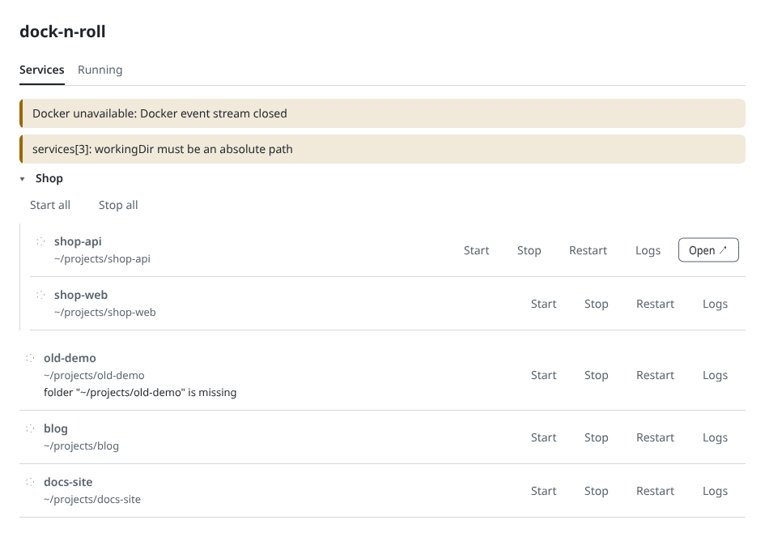 |
| 320 | 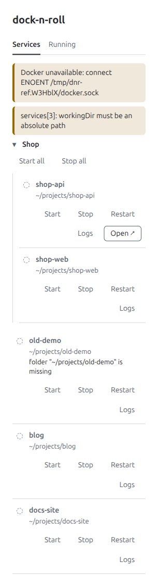 | 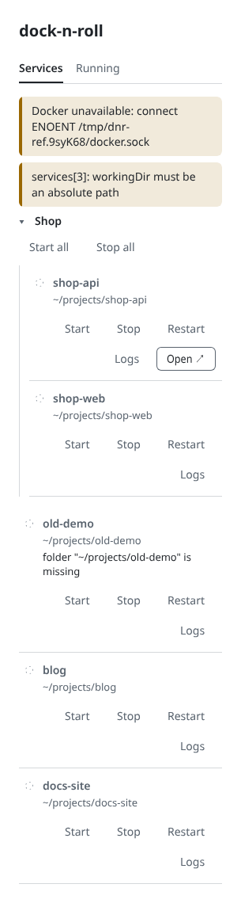 |

### Frame sizes

| Frame | Penpot (px) | App (px) |
|---|---|---|
| `service-list-960` | 960 × 575 | 960 × 600 (window height; the content is shorter) |
| `service-list-320` | 305 × 993 | 305 × 982 |
| `logs-panel-960` | 945 × 812 | 945 × 805 |
| `logs-panel-320` | 305 × 1348 | 305 × 1337 |
| `running-tab-960` | 945 × 813 | 945 × 804 |
| `running-tab-320` | 305 × 1282 | 305 × 1311 |
| `banners-960` | 945 × 663 | 945 × 655 |
| `banners-320` | 305 × 1140 | 305 × 1128 |

## Known differences

- **Height**: Penpot rounds each text line up to a whole pixel (19.6 px becomes 20 px), so a frame is 8 to 13 px taller than the app.
- **Line breaks**: the app breaks a long string anywhere (`overflow-wrap: anywhere`); Penpot breaks at spaces only, so the breaks are typed by hand where the app breaks inside a word.
- **Running tab at 320 px**: the browser sizes the table columns from their content, a few pixels apart from the Penpot frame, so cells wrap at other places and the app is 29 px taller. The app's table also runs 12 px into the right padding (#132).
- **Logs box**: the app caps it at 300 px and scrolls; the frame clips it at the same height, without a scrollbar. The app's scrollbar narrows the text, so one line at 320 px breaks earlier.
- **Container select**: the app draws the native `<select>` arrow; the frames use a `⌵` glyph.
- **Greyed badge**: the dashed 1 px border is drawn as a dotted stroke.
- **Group marker**: `▾` is a text glyph, slightly smaller than in the app.
- **Rows in the screens** are built like the `service-row` component but are not instances of it.
- **Themes**: the plugin API reports both themes as inactive; the dark exports were made by enabling `color/dark` in place of `color/light`.
- **Not covered**: the tray menu (native), the hover and focus states, the empty and loading states.

## Method

- Reference: a throwaway script drives the packaged app over the Chrome DevTools Protocol (CDP), under Xvfb, with a fake Docker daemon, a fake `ss` and a temporary home; it also records the position, size and computed style of each element, which the Penpot frames reuse. The geometry and the screenshots come from the same layout.
- Penpot: everything was created through the Penpot MCP (Model Context Protocol) server, `execute_code` with the plugin API, then compared with the reference side by side.

## What the MCP can and cannot export

| Artefact | Through the MCP | How it was produced |
|---|---|---|
| PNG and SVG of a frame or component | Yes (`export_shape`, or `shape.export()` in `execute_code`) | MCP |
| Tokens JSON | No native export: the plugin API exposes `tokens.sets` and `tokens.themes` only, so a script must assemble the JSON | Taken from the `.penpot` archive; a script-assembled copy has the same 39 tokens |
| `.penpot` file | No: `penpot.currentFile.export('penpot' \| 'zip')` fails with `No matching clause` in 2.19.3 | Menu > File > Download Penpot file, in the browser |

The lessons for the future `penpot` skill are in agents-skills#556.
